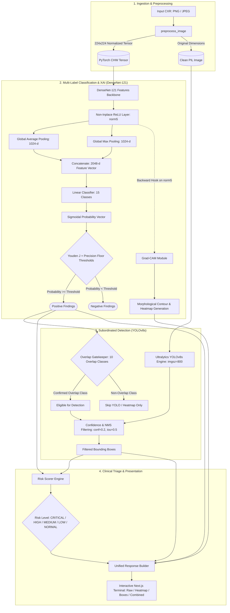

# Neuro: Multimodal Chest X-Ray Diagnostic Engine


**Neuro** is a clinical-grade diagnostic engine for frontal chest radiographs (CXR). It fuses multi-label deep disease classification, pixel-level Explainable AI (XAI) attention heatmaps, and subordinated bounding-box object detection into a unified, actionable clinical triage pipeline.

---

## 1. System Architecture & Multimodal Pipeline

Neuro implements a **Dual-Model Gatekeeper Pipeline**. High-sensitivity classification drives and constrains high-precision spatial detection to systematically suppress false-positive hallucinations.



---

## 2. Directory Structure

```
NeuroChestAnalysis/
├── backend/                          # FastAPI Backend Application
│   ├── main.py                       # App lifecycle, CORS, /health and /predict endpoints
│   ├── model_loader.py               # Custom DenseNet-121 architecture & model weight loader
│   ├── densenet_inference.py         # DenseNet forward pass & Grad-CAM extraction
│   ├── yolo_inference.py             # Subordinated YOLOv8s object detection
│   ├── risk_scorer.py                # Triage severity index & diagnostic edge flags
│   ├── response_builder.py           # Unified JSON & composite base64 image compiler
│   └── utils.py                      # Image normalization, PIL/NumPy/Base64 encoders
├── frontend/                         # Next.js 16 Client Application
│   ├── app/                          # App Router pages (Terminal, Benchmark, Auth)
│   ├── components/                   # React components (Viewer, SampleGallery, Navbar)
│   ├── lib/                          # State management (Zustand), Supabase, GSAP, Lenis
│   └── public/                       # Static benchmark assets & clinical sample CXRs
├── training/                         # Modular Re-Training & Customization Package
│   ├── config.yaml                   # Centralized training & hyperparameter configuration
│   ├── dataset.py                    # Multi-label CXR dataset loader with augmentations
│   ├── model.py                      # Modular DenseNetCustom with Dual Pooling Head
│   ├── train.py                      # Full CLI training engine with mixed-precision & metrics
│   ├── evaluate.py                   # Model evaluation, ROC-AUC & Youden threshold calibration
│   └── validate_run.py               # Sanity check script for convergence & checkpointing
├── hf_space/                         # Containerization for Hugging Face Spaces
│   ├── Dockerfile                    # Production Dockerfile (Python 3.11, PyTorch CPU-only)
│   └── requirements.txt              # HF runtime dependencies
├── models/                           # Model weights & threshold JSON configurations
│   ├── nih-model.pth                 # Trained DenseNet checkpoint (git-ignored)
│   ├── best_chestxdet.pt             # Trained YOLOv8s checkpoint (git-ignored)
│   ├── thresholds_and_metrics.json   # Optimal probability & CAM thresholds
│   └── yolo_pipeline_config.json     # Detection mappings & overlap classes
├── pyproject.toml                    # Modern PEP 621 Python packaging metadata
├── setup.py                          # Setuptools installer
├── requirements.txt                  # Python dependencies pinned for compatibility
├── LICENSE                           # Apache 2.0 Open-Source License & Attribution
└── README.md                         # Production documentation
```

---

## 3. Installation & Environment Setup

### Prerequisites
- Python 3.10 or 3.11 (Recommended: Conda `neuro` environment)
- Node.js 18+ or 20+ & npm

### Backend Environment Setup
```bash
# 1. Create and activate dedicated environment
conda create -n neuro python=3.11 -y
conda activate neuro

# 2. Install PyTorch 2.3.0 CPU-only wheels
pip install torch==2.3.0 torchvision==0.18.0 --index-url https://download.pytorch.org/whl/cpu

# 3. Install remaining production dependencies
pip install -r requirements.txt
```

### Frontend Setup
```bash
cd frontend
cp .env.local.template .env.local
# Configure your NEXT_PUBLIC_SUPABASE_URL, NEXT_PUBLIC_SUPABASE_ANON_KEY, and NEXT_PUBLIC_BACKEND_URL
npm install
```

---

## 4. Re-Training & Custom Dataset Preparation

The model can be retrained cleanly from scratch or fine-tuned on any custom chest radiograph dataset.

### Step 1: Format Your Dataset CSV
Your CSV file (e.g., `data/train.csv`) must contain an image path column and binary label columns (or a pipe-separated string):
```csv
image_path,Atelectasis,Cardiomegaly,Effusion,Infiltration,Mass,Nodule,Pneumonia,Pneumothorax,Consolidation,Edema,Emphysema,Fibrosis,Pleural_Thickening,Hernia,No Finding
00001.png,0,1,1,0,0,0,0,0,0,0,0,0,0,0,0
00002.png,0,0,0,0,0,0,0,0,0,0,0,0,0,0,1
```

### Step 2: Configure Hyperparameters
Edit [`training/config.yaml`](training/config.yaml) or provide CLI arguments:
```yaml
train_csv: "data/train.csv"
val_csv: "data/val.csv"
images_dir: "data/images"
batch_size: 16
lr: 0.0001
epochs: 15
device: "cuda"
use_pos_weight: true
checkpoint_dir: "models"
```

### Step 3: Run Training
```bash
# Execute training via configuration file:
python -m training.train --config training/config.yaml

# Or execute with custom CLI overrides:
python -m training.train \
  --train_csv data/train.csv \
  --val_csv data/val.csv \
  --images_dir data/images \
  --batch_size 32 \
  --lr 0.0001 \
  --epochs 20 \
  --device cuda \
  --checkpoint_dir models
```

### Step 4: Calibrate Optimal Clinical Thresholds
Compute per-class Youden J statistics and export the runtime configuration:
```bash
python -m training.evaluate \
  --model models/nih-model.pth \
  --csv data/val.csv \
  --images_dir data/images \
  --output models/thresholds_and_metrics.json
```

---

## 5. Verification & Dry-Run Sanity Check

To verify training loss convergence and checkpoint saving without waiting for large datasets:
```bash
python -m training.validate_run
```
*Expected Output:*
```text
ALL SANITY CHECKS PASSED: Model, Loss, Optimizer & Checkpointing Validated.
Loss dropped by >99% across 10 gradient steps.
Checkpoint serialization & parity restored (max diff < 1e-6).
```

---

## 6. Execution & Deployment

### Running the API Backend
```bash
# Normal inference mode (requires models/ directory):
uvicorn backend.main:app --host 0.0.0.0 --port 8000 --reload

# Mock inference mode (runs without heavy weights for testing):
export MOCK_INFERENCE=true
uvicorn backend.main:app --host 0.0.0.0 --port 8000 --reload
```

### Running the Next.js Frontend
```bash
cd frontend
npm run dev
# Terminal accessible at http://localhost:3000
```

### Container Deployment (Docker / Hugging Face Spaces)
```bash
docker build -t neuro-backend -f hf_space/Dockerfile .
docker run -p 7860:7860 neuro-backend
```

---

## 7. Model Benchmarks

| Condition | DenseNet AUC | CheXNet Baseline | Delta |
| :--- | :---: | :---: | :---: |
| **Cardiomegaly** | **0.912** | 0.925 | -0.013 |
| **Pneumothorax** | **0.865** | 0.889 | -0.024 |
| **Effusion** | **0.858** | 0.864 | -0.006 |
| **Mass** | **0.841** | 0.868 | -0.027 |
| **Emphysema** | **0.892** | 0.937 | -0.045 |
| **Mean Validation AUC** | **0.793** | 0.841 | -0.048 |

---

## 8. Authorship, Maintainer & License

### Principal Maintainer & Architect
- **Debashis Mohapatra**
- Email: [debashismohapatra8260@gmail.com](mailto:debashismohapatra8260@gmail.com)
- Year: **2026**

### License & Compliance
This project is licensed under the **Apache License 2.0**.
- Original architecture and early prototypes: Copyright (c) 2024–2025 Sagar Sarangi.
- Derivative works, refactored components, modular training pipelines, and retrained models: Copyright (c) 2026 Debashis Mohapatra.
- See the [`LICENSE`](LICENSE) file for complete terms.
