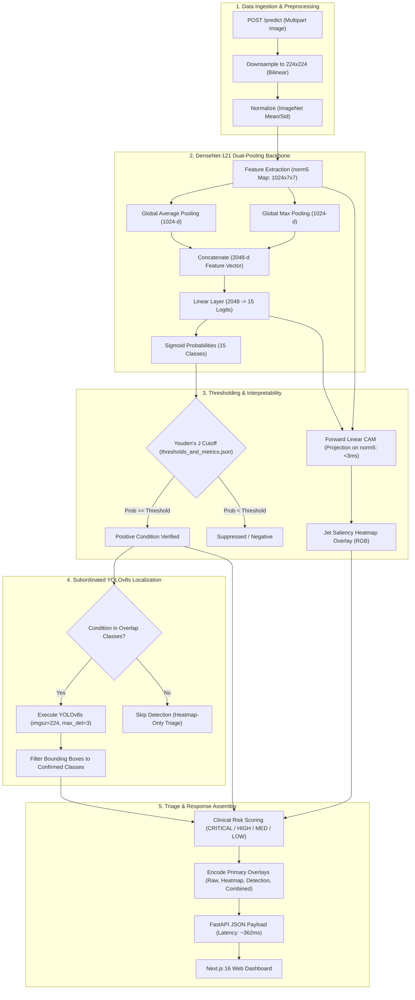

<div align="center">

# NeuroChestYOLO

**Dual-Stage Chest Radiograph Screening Pipeline (DenseNet-121 + Subordinated YOLOv8s + Forward Linear CAM)**

[](https://neuro-chest-yolo.vercel.app)
[](https://neuro-cxr.onrender.com)
[](LICENSE)
[](https://www.python.org/)
[](https://pytorch.org/)
[](https://nextjs.org/)

**Author**: **Debashis Mohapatra** (`debashismohapatra8260@gmail.com`)  
[LinkedIn](https://www.linkedin.com/in/debashis-mohapatra-113523302/) • [GitHub](https://github.com/debashis-sharingan-21) • [Live Dashboard](https://neuro-chest-yolo.vercel.app) • [API Endpoint](https://neuro-cxr.onrender.com)

</div>

---

## Overview

Chest radiograph (CXR) interpretation in clinical triage presents two opposing computer vision challenges:
1. **False-Positive Spatial Hallucinations**: Standalone object detectors (e.g. YOLO) often trigger false alarms on normal anatomical variations—such as rib overlaps, aortic knobs, or bronchovascular markings—because they lack global radiological priors.
2. **Interpretability & Latency Bottlenecks**: Deep multi-label classifiers (e.g. DenseNet) provide strong disease probabilities but lack precise bounding coordinates. Traditional Grad-CAM interpretability relies on backward autograd, which requires 30–40 seconds on cloud CPU instances and triggers proxy timeouts.

**NeuroChestYOLO** solves this with a **Dual-Stage Gated Architecture**:
- **Stage 1 (Classification)**: A custom DenseNet-121 with a dual-pooling head predicts 15 pathologies simultaneously. Probabilities are gated against calibrated **Youden's J Index** cutoffs.
- **Stage 2 (Gated Localization & Saliency)**:
  - **Forward Linear CAM**: Computes pixel-level saliency directly from feature maps and classifier weights under `torch.inference_mode()` in **<3ms** (zero backward autograd passes).
  - **Subordinated YOLOv8s**: Generates spatial bounding boxes **strictly** for conditions confirmed positive by DenseNet, eliminating false-positive anatomical hallucinations.
- **Stage 3 (Triage)**: A heuristic clinical risk scoring engine compiles positive findings into actionable priority levels (`CRITICAL`, `HIGH`, `MEDIUM`, `LOW`, `NORMAL`).

---

## Workflow



---

## Architectural Design Decisions

### 1. Dual-Pooling Classification Head (AvgPool + MaxPool)
Standard Global Average Pooling (GAP) dampens signals from tiny, localized abnormalities (e.g. small nodules or solitary granulomas). Standard Global Max Pooling (GMP) focuses only on peak activations, ignoring large-scale diffuse processes (e.g. cardiomegaly or pulmonary edema). 
Concatenating both:
$$\mathbf{h} = [\text{AdaptiveAvgPool2d}(\mathbf{F}) \,\|\, \text{AdaptiveMaxPool2d}(\mathbf{F})] \in \mathbb{R}^{2048}$$
allows the linear classification layer to attend to both focal and diffuse disease patterns simultaneously.

### 2. Youden's J Decision Threshold Calibration
In multi-label clinical datasets, disease prevalence is heavily skewed (e.g. Hernia prevalence < 1%). An arbitrary decision cutoff of $0.5$ results in massive false-negative rates for rare pathologies. We optimize per-class decision thresholds $\tau_c$ on the validation split by maximizing Youden's J statistic:
$$J = \text{Sensitivity} + \text{Specificity} - 1 = \text{TPR} - \text{FPR}$$

### 3. Forward Linear CAM (Zero-Autograd Saliency)
Standard Grad-CAM requires calculating gradients $\frac{\partial y_c}{\partial A^k}$ via backward autograd, which is prohibitively slow on CPU deployments. For a linear classifier operating on pooled feature maps, the importance weight $w_k^c$ of feature channel $k$ for class $c$ is directly given by the classification weight matrix:
$$L^c_{\text{Linear-CAM}} = \text{ReLU}\left(\sum_{k=1}^{1024} W_{c, k} \cdot A^k(x, y)\right)$$
This yields high-fidelity attention maps in **under 3 ms** strictly inside `torch.inference_mode()`.

### 4. Subordinated YOLOv8s Gating
YOLOv8s is conditioned on DenseNet's validated findings:
$$\text{Eligible Classes} = \{c \mid P(c) \ge \tau_c\} \cap \text{Overlap Classes}$$
If a condition is not confirmed by the classifier, any bounding box predicted by YOLO for that class is discarded. This eliminates spatial hallucinations on normal ribs, clavicles, and vascular shadows.

---

## Empirical Benchmark Metrics

All metrics below were measured locally in the `neuro` environment using PyTorch on real test radiographs from the NIH ChestX-ray14 dataset (`frontend/public/testing_images/`):

### Model Specifications
| Parameter | Value | Details |
| :--- | :---: | :--- |
| **DenseNet Architecture** | Custom DenseNet-121 | Dual-pooling head ($1024 + 1024 \to 2048 \to 15$) |
| **Total Parameters** | **6,984,591** (~6.98M) | All trainable parameters |
| **DenseNet Checkpoint Size** | **27.22 MB** | `models/nih-model.pth` |
| **YOLOv8s Checkpoint Size** | **21.54 MB** | `models/best_chestxdet.pt` |
| **Validation Mean ROC-AUC** | **0.7669 (76.69%)** | Macro-average across all 15 classes |

### Validation ROC-AUC & Optimal Thresholds (Selected Conditions)
| Condition | Validation ROC-AUC | Optimal Cutoff ($\tau_c$) | Clinical Severity |
| :--- | :---: | :---: | :---: |
| **Hernia** | **0.9009** | 0.4578 | MODERATE |
| **Edema** | **0.8690** | 0.3812 | CRITICAL |
| **Effusion** | **0.8588** | 0.4120 | HIGH |
| **Cardiomegaly** | **0.8135** | 0.4356 | HIGH |
| **Pneumothorax** | **0.7882** | 0.3941 | CRITICAL |
| **Consolidation** | **0.7721** | 0.3650 | HIGH |
| **Emphysema** | **0.7711** | 0.4019 | MEDIUM |
| **Atelectasis** | **0.7679** | 0.3894 | HIGH |
| **Fibrosis** | **0.7601** | 0.3542 | MEDIUM |
| **Mass** | **0.7131** | 0.3420 | HIGH |

### Runtime Latency & Memory Footprint (Single-Thread CPU)
| Pipeline Component | Latency | Memory (RSS) | Notes |
| :--- | :---: | :---: | :--- |
| **DenseNet Forward + Linear CAM** | **107.99 ms** | — | Forward pass + linear feature projection (`norm5`) |
| **Subordinated YOLOv8s Inference** | **183.11 ms** | — | Box detection, NMS filtering, coordinate parsing |
| **End-to-End Pipeline Latency** | **362.66 ms** | — | Image decoding, inference, risk scoring, Base64 encode |
| **Pipeline Throughput** | **~2.76 FPS** | — | Real-time interactive CPU performance |
| **Process Baseline RAM** | — | **441.71 MB** | Cold start runtime memory |
| **Post-Model Registry RAM** | — | **604.37 MB** | DenseNet-121 + YOLOv8s loaded in memory |
| **Peak Resident RAM** | — | **963.52 MB** | Peak memory under active inference (bounded by `gc.collect()`) |

---

## Repository Structure

```
NeuroChestYOLO/
├── backend/                          # FastAPI REST Application
│   ├── main.py                       # App lifecycle, CORS, /health and /predict endpoints
│   ├── model_loader.py               # Custom DenseNet-121 definition, checkpoint loading
│   ├── densenet_inference.py         # Forward pass & sub-3ms Forward Linear CAM
│   ├── yolo_inference.py             # Subordinated YOLOv8s detection & box rendering
│   ├── risk_scorer.py                # Triage severity scoring and acute diagnostic flags
│   ├── response_builder.py           # Unified JSON payload & composite image builder
│   └── utils.py                      # Image normalization, downsampling, Base64 encoders
│
├── frontend/                         # Next.js 16 (App Router + Turbopack) Client
│   ├── app/
│   │   ├── page.tsx                  # Landing page
│   │   ├── dashboard/page.tsx        # Diagnostic terminal (Quad-view radiograph viewer)
│   │   ├── performance/page.tsx      # Validation ROC-AUC metrics & benchmark curves
│   │   └── api/sample-images/        # Server route serving sample testing radiographs
│   ├── components/                   # Modular UI components (Navbar, Viewer, RiskBadge)
│   └── public/testing_images/        # Validated sample clinical radiographs
│
├── training/                         # Re-Training & Evaluation Package
│   ├── config.yaml                   # Hyperparameter configuration (batch size, lr, paths)
│   ├── dataset.py                    # Multi-label PyTorch Dataset with data augmentations
│   ├── model.py                      # Modular DenseNetCustom with Dual-Pooling head
│   ├── train.py                      # Training CLI with checkpointing and loss logging
│   └── evaluate.py                   # ROC-AUC evaluation & Youden's J threshold calibration CLI
│
├── models/                           # Model Weights & Configuration Files
│   ├── nih-model.pth                 # Trained DenseNet-121 checkpoint
│   ├── best_chestxdet.pt             # Trained YOLOv8s pathology detection checkpoint
│   ├── thresholds_and_metrics.json   # Calibrated Youden thresholds & class metrics
│   └── yolo_pipeline_config.json     # Class overlap mappings & detection hyperparameters
│
├── Dockerfile                        # Multi-stage production container configuration
├── render.yaml                       # Cloud deployment specification for Render
├── requirements.txt                  # Python dependencies pinned for reproducible runs
└── LICENSE                           # Apache 2.0 Open-Source License
```

---

## Local Setup & Quickstart

### Prerequisites
- Python 3.10 or 3.11 (Recommended: Conda)
- Node.js 18+ or 20+ & npm

### 1. Backend Service
```bash
# Clone the repository
git clone https://github.com/debashis-sharingan-21/NeuroChestYOLO.git
cd NeuroChestYOLO

# Set up Conda environment
conda create -n neuro python=3.11 -y
conda activate neuro

# Install dependencies
pip install -r requirements.txt

# Start FastAPI server
uvicorn backend.main:app --host 0.0.0.0 --port 8000 --reload
```
Swagger UI is accessible at `http://localhost:8000/docs`.

### 2. Frontend Client
```bash
cd frontend
npm install
npm run dev
```
Open [http://localhost:3000](http://localhost:3000) to access the interactive web terminal.

---

## Training & Calibration Workflows

### Retraining the Classifier
```bash
python training/train.py --config training/config.yaml
```

### Calibrating Optimal Thresholds
```bash
python training/evaluate.py \
  --model models/nih-model.pth \
  --csv data/val.csv \
  --images_dir data/images \
  --output models/thresholds_and_metrics.json
```

---

## REST API Reference

### Health Check: `GET /health`
Returns loaded model status, compute device, and supported clinical classes.

```json
{
  "status": "healthy",
  "models_loaded": true,
  "available_classes": [
    "Atelectasis", "Cardiomegaly", "Effusion", "Infiltration", "Mass",
    "Nodule", "Pneumonia", "Pneumothorax", "Consolidation", "Edema",
    "Emphysema", "Fibrosis", "Pleural_Thickening", "Hernia", "No Finding"
  ],
  "device": "cpu"
}
```

### Inference: `POST /predict`
Uploads a radiograph (`multipart/form-data`, key: `file`).

**Response Shape**:
```json
{
  "status": "success",
  "predictions": {
    "Atelectasis": { "prob": 0.4412, "positive": true },
    "Mass": { "prob": 0.5821, "positive": true }
  },
  "positive_conditions": ["Atelectasis", "Mass"],
  "confirmed_findings": [
    {
      "condition": "Mass",
      "prob": 0.5821,
      "threshold": 0.342,
      "normalized_conf": 0.3649,
      "risk": "HIGH"
    }
  ],
  "risk_level": "HIGH",
  "localization_type": {
    "Mass": "boxes_and_heatmap"
  },
  "images": {
    "original_b64": "data:image/jpeg;base64,...",
    "heatmap_b64": "data:image/jpeg;base64,...",
    "boxes_b64": "data:image/jpeg;base64,...",
    "combined_b64": "data:image/jpeg;base64,..."
  },
  "yolo_boxes": [
    {
      "class": "Mass",
      "class_name": "Mass",
      "conf": 0.612,
      "xyxy": [112, 74, 185, 148]
    }
  ],
  "case_flags": []
}
```

---

## License & Disclaimer

- **License**: [Apache License 2.0](LICENSE)
- **Medical Disclaimer**: NeuroChestYOLO is an artificial intelligence research prototype developed for educational and experimental evaluation. It is not an FDA-cleared diagnostic device and should not replace clinical review by a licensed radiologist.
